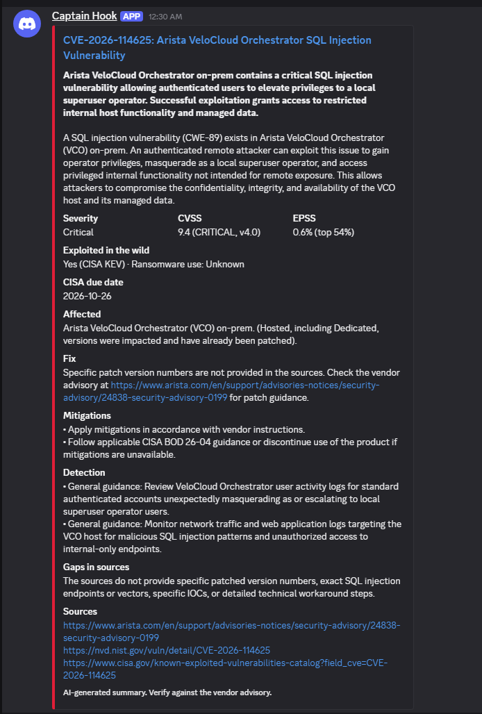
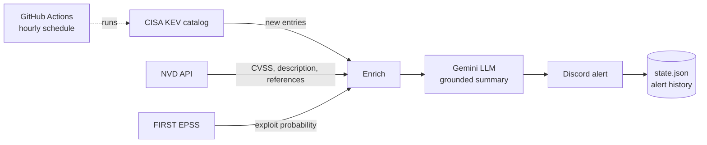

# Cyber Notifier

**Automated alerts for actively exploited vulnerabilities, with AI-written summaries grounded in official sources.**

Cyber Notifier watches CISA's Known Exploited Vulnerabilities (KEV) catalog, enriches each new entry with severity and exploit-likelihood data, uses an LLM to turn it into a clear, actionable alert, and posts it to Discord. It runs every hour on GitHub Actions at no cost.



---

## Why this exists

Thousands of CVEs are published every month, but only a small fraction are actually exploited in the wild. Security teams need to know about *those* quickly, in plain language, with clear remediation steps, without wading through raw advisories.

Cyber Notifier focuses only on confirmed exploitation and delivers each alert in a consistent, scannable format for both managers and engineers.

## How it works



1. **Detect.** Pull the CISA KEV catalog and compare it against previously alerted CVEs.
2. **Enrich.** For each new CVE, fetch CVSS score, full description, and references from NVD, plus an EPSS exploit-probability score.
3. **Summarize.** Send the combined data to an LLM with strict grounding rules and a fixed output schema.
4. **Alert.** Post a color-coded embed to Discord with severity, scores, affected products, fix, mitigations, detection ideas, and source links.
5. **Remember.** Record alerted CVEs in `state.json`, committed back to the repo by the workflow, so nothing is sent twice.

## Key design decisions

**Confirmed exploitation as the trigger.**
CISA KEV only lists vulnerabilities with evidence of active exploitation. This keeps alerts high-signal and avoids the noise of alerting on every new CVE.

**Grounded AI output: no invented fixes.**
A hallucinated patch version or registry key in a security alert is worse than no alert. The model is instructed to use only the provided source data and to never invent patch versions, KB numbers, configuration changes, or IOCs. When the sources don't state a fix, the alert says so and points to the vendor advisory. Every alert includes:
- source links for verification
- a **"Gaps in sources"** field listing what the data did *not* say
- detection ideas labeled as general guidance when they aren't vendor-confirmed

**Structured output.**
The LLM returns JSON validated against a Pydantic schema (`tldr`, `technical_summary`, `affected`, `severity`, `fix`, `mitigations`, `detection`, `gaps`), so every alert has the same shape and can feed other channels or a future app.

**Built for free-tier limits.**
- NVD requests are throttled to stay under its public rate limit (faster automatically when an API key is provided).
- LLM calls retry with backoff on rate-limit (429) and overload (500/503) errors.
- Each run processes a capped number of alerts, and one failed CVE doesn't stop the rest. It's retried on the next run.

**Secrets never touch the code.**
API keys and the webhook URL live in a local `.env` file (git-ignored) and in encrypted GitHub Actions secrets.

## Example alert fields

| Field | Source |
|---|---|
| Title, vendor/product | CISA KEV |
| TL;DR and technical summary | LLM (from source data only) |
| CVSS score and severity | NVD |
| EPSS probability and percentile | FIRST EPSS |
| Exploited in the wild, ransomware use, CISA due date | CISA KEV |
| Affected, Fix, Mitigations, Detection, Gaps | LLM (from source data only) |
| Sources | Vendor advisory, NVD, CISA references |

## Tech stack

- **Python 3**: `requests`, `python-dotenv`, `google-genai`, `pydantic`
- **Data sources**: [CISA KEV](https://www.cisa.gov/known-exploited-vulnerabilities-catalog), [NVD API 2.0](https://nvd.nist.gov/developers), [FIRST EPSS](https://www.first.org/epss/)
- **LLM**: Google Gemini API, with structured JSON output
- **Delivery**: Discord webhooks
- **Automation**: GitHub Actions (hourly cron and manual trigger)

## Project structure

```
cyber-notifier/
├── .github/workflows/notify.yml   # hourly schedule + manual run, persists state
├── main.py                        # orchestrates the pipeline, tracks alerted CVEs
├── ingest.py                      # CISA KEV, NVD, and EPSS collection and enrichment
├── summarize.py                   # grounded LLM summarization with schema validation
├── notify.py                      # Discord embed formatting and delivery
├── requirements.txt
└── state.json                     # IDs of CVEs already alerted
```

## Running it

### Locally

```bash
python -m venv .venv
.venv\Scripts\activate          # Windows (macOS/Linux: source .venv/bin/activate)
pip install -r requirements.txt
```

Create a `.env` file:

```
GEMINI_API_KEY=your-key
DISCORD_WEBHOOK_URL=your-webhook-url   # optional: alerts print to the terminal if blank
NVD_API_KEY=your-key                   # optional: faster NVD lookups
```

Then run:

```bash
python main.py
```

On the first run, it records the existing catalog and alerts only on the newest few entries, so you aren't flooded with historical alerts.

### On GitHub Actions

1. Add `GEMINI_API_KEY` and `DISCORD_WEBHOOK_URL` (and optionally `NVD_API_KEY`) under **Settings → Secrets and variables → Actions**.
2. The workflow runs hourly. To run it on demand, go to **Actions → Cyber notifier → Run workflow**.

## Limitations

- Alerts trigger when CISA adds a vulnerability to KEV, which can lag a vendor's initial disclosure by hours or days.
- Summaries are AI-generated from public data. Always verify remediation steps against the vendor advisory before acting.

---

Built by **Cruz Esquivel**, Security Engineer · [LinkedIn](https://www.linkedin.com/in/your-profile)

© Cruz Esquivel. All rights reserved.